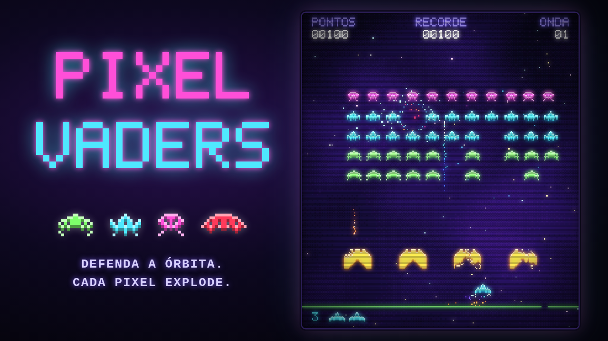

<p align="center">
  
</p>

<h1 align="center">PIXEL VADERS</h1>

<p align="center">
  <b>Defenda a órbita. Cada pixel explode.</b><br>
  Um shooter de arcade em pixel art, com regras dos fliperamas de 1978 e efeitos de partículas modernos.
</p>

<p align="center">
  <a href="https://bitman.sandrigo.com.br"><b>▶ Jogar no Bitman</b></a>
</p>

---

## A ameaça

Uma frota de 55 invasores surgiu da nebulosa e desce em formação direto para a sua base.
Você controla o último canhão em órbita, atrás de quatro escudos que vão se desfazendo a cada tiro.

Quanto menos invasores restam, **mais rápido os sobreviventes marcham**. Se algum deles chegar ao chão, a partida acaba na hora.

## Controles

| Ação | Teclado | Celular |
| --- | --- | --- |
| Mover | `←` `→` ou `A` `D` | botões ◀ ▶ |
| Atirar | `Espaço` (ou `↑` / `W`) | botão **FOGO** |
| Começar | `Enter` ou clique na tela | toque na tela |
| Pausar | `P` ou `Esc` | — |
| Ligar/desligar som | `M` | — |

> Jogando no navegador do computador? Clique na tela do jogo uma vez para ele receber o teclado.

## Pontuação

| Invasor | Pontos |
| --- | --- |
| Sentinela (fileira de cima, rosa) | **30** |
| Arraia (fileiras do meio, ciano) | **20** |
| Rastejante (fileiras de baixo, verde) | **10** |
| Nave misteriosa (vermelha, passa pelo topo) | **50 a 300** |

- Você começa com **3 vidas** e ganha **uma vida extra aos 1.500 pontos**.
- Limpou a formação? Os escudos são reconstruídos e a próxima onda **começa mais perto do chão**.

## Dicas de veterano

- **Um tiro de cada vez.** Seu canhão só dispara de novo quando o tiro anterior acerta algo ou sai da tela. Errar custa caro.
- **Os escudos protegem dos dois lados.** Eles param os tiros inimigos, mas também os seus. Abrir uma fresta no escudo cria uma janela de tiro segura.
- **Tiro contra tiro.** Seu disparo pode destruir um projétil inimigo no ar.
- **Cuidado com a espiral vermelha.** Dos três tipos de tiro inimigo, ela é o que mira na coluna em que você está. Não fique parado.
- **A nave misteriosa não é aleatória.** O valor dela depende de quantos tiros você já disparou na partida. Os veteranos contam os tiros para pegar os 300 pontos.
- **Ataque pelas bordas.** Eliminar as colunas das pontas faz a formação levar mais tempo para chegar à borda e descer.
- **O último invasor é o mais perigoso.** Sozinho, ele cruza a tela em velocidade máxima.

## O que torna o jogo especial

- **Pixel art de verdade**: o jogo roda em 224×256, a resolução dos gabinetes clássicos, e é ampliado sem suavização.
- **Partículas por toda parte**: cada pixel de um invasor abatido vira um estilhaço, as explosões geram ondas de choque que empurram as partículas ao redor, e os escudos soltam destroços que caem e quicam no chão.
- **Clima de fliperama**: brilho neon, scanlines de CRT, tremor de tela e uma nebulosa em pixel no fundo.
- **Som sintetizado** na hora, com a marcha dos invasores acelerando junto com a formação.
- **Joga em qualquer lugar**: teclado no computador e controles de toque no celular.

## Rodar no seu computador

Não precisa instalar nada. Baixe o repositório e abra o `index.html` no navegador.

```bash
git clone https://github.com/RafaelSandrigo/space-invaders.git
cd space-invaders
# abra o index.html no navegador
```

Fora do Bitman, o ranking não é usado e basta apertar `Enter` no fim de jogo para começar de novo.

---

<p align="center">Feito por Rafael Sandrigo · Licença MIT</p>
